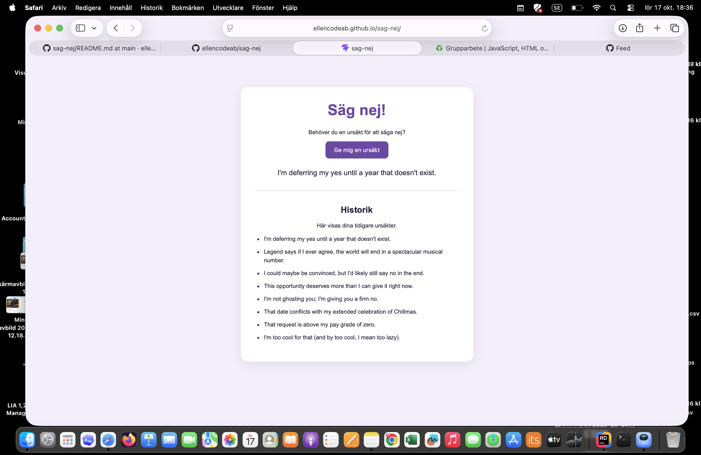
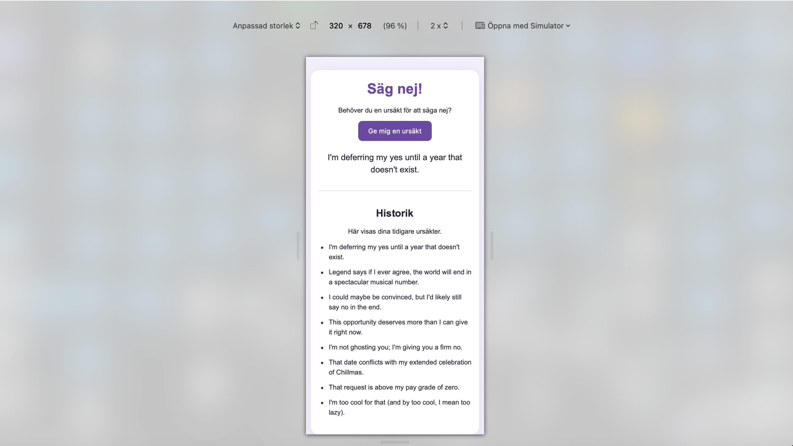
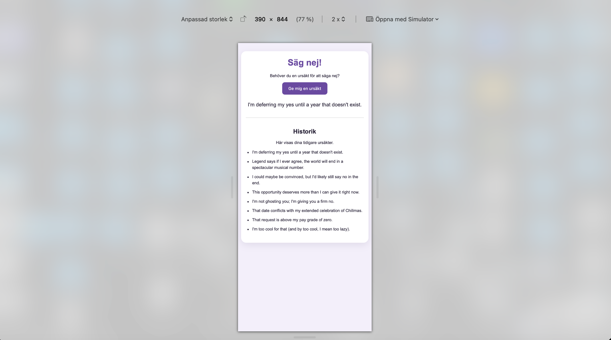

# Säg nej! – Webbapplikation

## Beskrivning

Säg nej! är en webbapplikation som hjälper användaren att hitta roliga ursäkter för att säga nej.

Användaren klickar på knappen **"Ge mig en ursäkt"** och får en slumpmässig ursäkt från ett externt API.

Applikationen har även en historik där tidigare genererade ursäkter visas.

## Länkar

- **Publicerad webbplats:** https://ellencodeab.github.io/sag-nej/
- **GitHub-repository:** https://github.com/ellencodeab/sag-nej

## Tekniker

Projektet är byggt med:

- HTML
- JavaScript och JavaScript-moduler
- Sass (SCSS)
- Vite
- No as a Service (NaaS) API
- Git och GitHub
- GitHub Actions och GitHub Pages

## Funktioner

- Hämta en ny ursäkt genom att klicka på en knapp.
- Visa ursäkten direkt på sidan.
- Spara och visa tidigare ursäkter i en historik under samma besök.
- Anpassad layout för olika skärmstorlekar.
- Visa ett meddelande om något går fel vid hämtning från API:et.

## Starta projektet lokalt

1. Klona repositoryt från GitHub.
2. Öppna projektmappen i en terminal.
3. Installera beroenden:

```bash
npm install
```

4. Starta utvecklingsservern:

```bash
npm run dev
```

5. Öppna den lokala adress som visas i terminalen.

## Arbetsprocess

Jag började med att skapa ett Vite-projekt och byggde sedan sidans struktur med HTML och JavaScript.

Därefter kopplade jag applikationen till No as a Service API för att hämta ursäkter. Jag lade också till en egen funktion som visar tidigare ursäkter i en historik.

Jag använde Sass för att skapa sidans design och anpassade layouten för olika skärmstorlekar.

Projektet versionshanteras med Git och GitHub. Webbplatsen byggs och publiceras via GitHub Actions och GitHub Pages.

## Individuellt arbete

Uppgiften var ursprungligen ett grupparbete, men jag har genomfört projektet individuellt med tillstånd från utbildningsledaren Hossein.

Därför har jag ansvarat för planering, programmering, testning och dokumentation själv.

## Reflektion

Under arbetet har jag fått öva på att skapa ett projekt med Vite, använda JavaScript för att hämta data från ett API och utveckla en egen funktion med historik.

Jag har också lärt mig mer om Sass, GitHub och hur man publicerar en webbapplikation automatiskt med GitHub Actions.

En utmaning var att konfigurera publiceringen på GitHub Pages. Genom att felsöka och testa kunde jag få webbplatsen att fungera.

## AI-stöd

Jag har använt ChatGPT som stöd för att förstå uppgiftsinstruktionerna, få förklaringar av HTML, CSS, JavaScript, Vite och GitHub samt för att felsöka problem under utvecklingen. Jag har själv genomfört och testat projektet.

## Skärmbild



### Mobilvy – 320 px



### Mobilvy – 390 px



## Reflektion

### 1. Vilka problem stötte du på med datahanteringen via API:er?

En utmaning var att förstå hur data hämtas från ett externt API och hur svaret ska visas på sidan. Jag behövde också tänka på vad som händer om API:et inte svarar. Genom att testa och felsöka fick jag en bättre förståelse för hur API-anrop fungerar.

### 3. Vad var lättare än förväntat i grupparbetet?

Att skapa sidans grundstruktur med HTML och CSS gick lättare än förväntat. När strukturen var på plats blev det också enklare att lägga till knappen och historiken.

### 4. Vad var svårare än förväntat i grupparbetet?

Det svåraste var att få publiceringen på GitHub Pages att fungera med Vite. Det tog tid att förstå inställningarna och hitta rätt lösning.

### 5. Vad var roligast?

Det roligaste var att se hur applikationen växte fram och till slut fungerade på riktigt. Särskilt roligt var det att få nya ursäkter från API:et och se dem sparas i historiken.

### 6. Vad var tråkigast?

Det minst roliga var när publiceringen inte fungerade och samma problem behövde felsökas flera gånger. Samtidigt var det en nyttig del av arbetet.

### 7. Hur väl höll gruppkontraktet? Motivera/reflektera.

Eftersom projektet genomfördes individuellt, enligt överenskommelse med utbildningsledaren Hossein, fanns inget gruppkontrakt. I stället behövde arbetet planeras och genomföras självständigt.

### 8. Hur fungerade rollerna i gruppen?

Det fanns ingen gruppindelning eftersom uppgiften gjordes individuellt. Ansvaret för planering, programmering, design, testning och dokumentation låg därför på mig.

### 9. Har alla i gruppen deltagit i samma utsträckning? Om inte, varför? Vem?

Uppgiften genomfördes individuellt med tillstånd från Hossein. Därför fanns inga andra gruppmedlemmar och allt arbete utfördes av mig.

### 10. Vad hade du gjort annorlunda om du skulle göra om projektet?

Nästa gång skulle jag börja med en tydligare plan och testa publiceringen tidigare. Då skulle det bli lättare att upptäcka problem i god tid.

### 11. Vad tar du med dig från detta projekt till framtida projekt?

En bättre förståelse för JavaScript, API-anrop, felhantering och hur Vite fungerar tillsammans med GitHub Pages. Jag har också lärt mig hur viktigt det är att testa och felsöka steg för steg.

### 12. Vad lämnar du efter dig (t.ex. dåliga vanor)?

Jag vill bli bättre på att planera tiden och undvika att skjuta upp svåra delar av arbetet. Det är bättre att börja tidigt och lösa ett problem i taget.

### 13. För- och nackdelar med agilt projektarbete: vad tycker du?

En fördel med agilt arbete är att projektet kan utvecklas stegvis och förbättras efter varje test. En nackdel är att det kan bli svårt att hålla ordning utan tydlig planering. Eftersom arbetet gjordes individuellt har jag främst fått erfarenhet av att arbeta stegvis och anpassa planen efter behov.

### 14. Övriga tankar, reflektioner, kommentarer

Projektet har varit både utmanande och lärorikt. Det känns bra att ha byggt en fungerande webbapplikation från början till slut. Jag har fått mer självförtroende i att arbeta med JavaScript och GitHub och vill fortsätta utveckla mina kunskaper.
